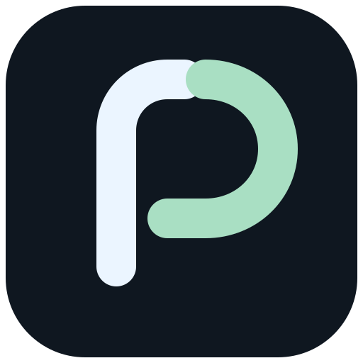
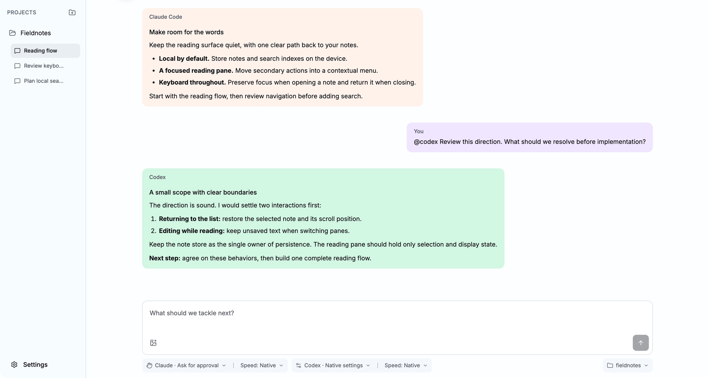

<p align="center">
  
</p>

<h1 align="center">Pact</h1>

<p align="center"><strong>Two agents. One shared intent.</strong></p>

<p align="center">
  A local-first collaborative workspace for Claude Code and Codex.<br>
  Your native tools and configuration. One conversation. You in control.
</p>

<p align="center">
  <a href="https://github.com/mbaxszy7/Pact/actions/workflows/ci-native.yml?query=branch%3Adev"></a>
  <a href="LICENSE"></a>
  <a href="#get-started"></a>
</p>

<p align="center">
  <a href="#why-pact">Why Pact</a> ·
  <a href="#a-shared-workspace">Features</a> ·
  <a href="#get-started">Get started</a> ·
  <a href="#cli-compatibility">CLI compatibility</a> ·
  <a href="#contributing">Contribute</a>
</p>

<p align="center">
  <picture>
    <source media="(prefers-color-scheme: dark)" srcset="docs/assets/workspace-dark.png">
    
  </picture>
</p>

<p align="center"><sub>Actual macOS app capture with staged demo conversation content. Window chrome cropped; no UI mockup.</sub></p>

## Why Pact

Good ideas should travel between agents without you carrying them from terminal to terminal.

Pact brings **Claude Code, Codex and you** into one local coding workspace. Ask either agent,
bring in a second perspective, and move from a plan to implementation and review in the same
conversation. You choose who acts and when.

- **Keep your native setup.** Each agent retains its own authentication, models, project instructions,
  Skills, MCP servers, Plugins, Hooks and tools. Pact coordinates the installed CLIs.
- **Give the work a shared home.** Conversations, plans, comments, review findings and recorded file
  changes stay connected to the local project that produced them.
- **Keep control of the next step.** Explicit routing, native permissions and user-approved handoffs
  make collaboration deliberate. Default orchestration is deterministic. Optional Relay uses a
  separately selected model for bounded scheduling advice, with execution still owned by Pact.

### Local data. Native connections.

Projects, Pact session records, managed images and diagnostics are stored locally. Claude Code and
Codex keep separate native contexts and credentials; Pact shares relevant conversation sources
without merging their private histories or configuration.

**Local storage does not mean offline inference.** Agent requests and native tools can send prompts,
project content, attachments and tool results to your configured providers and services. Your existing
accounts, model access, usage limits and provider fees still apply.

## A shared workspace

| From intent to result     | What you can do                                                                                                        |
| ------------------------- | ---------------------------------------------------------------------------------------------------------------------- |
| **Two perspectives**      | Route to Claude, Codex or `@all`. Bring relevant conversation history across when changing agents.                     |
| **Plan, build, review**   | Use `/plan`, `/build` and `/review` with one versioned plan, natural review reports and explicit writing decisions.    |
| **Point to what matters** | Send images and comments anchored to messages, plans or file selections alongside your prompt.                         |
| **See what changed**      | Inspect recorded file changes and undo an eligible Changes card after conflict checks.                                 |
| **Continue with context** | Continue native agent histories, fork a conversation at a completed answer, or explicitly recover a disrupted session. |
| **Make room for focus**   | Switch between light and dark themes, close the contextual pane, and choose optional platform-dependent translucency.  |

`@all` asks Primary, then Secondary; Secondary does not see Primary's answer from that round.
Both agents still work against the same project files. A conversation fork branches native histories,
not the filesystem; Undo applies to eligible recorded changes, not a full workspace snapshot.

## Get started

Pact is under active development. Supported desktop targets are **macOS Apple silicon**,
**Windows x64** and **Windows arm64**.

### Run from source

You will need Node.js **24.18.1**, Corepack, pnpm **12.11.2**, and both CLIs installed and authenticated
separately. On Windows, also install Python 3 and Visual Studio Build Tools with
**Desktop development with C++** for Electron's native dependencies.

```sh
git clone https://github.com/mbaxszy7/Pact.git
cd Pact
corepack enable
pnpm install --frozen-lockfile
pnpm dev
```

On first launch, Pact checks both CLIs and asks you to save default session settings. Then add a local
project, create a session, and choose the agent for your first message. Returning users can read
existing content while a CLI is unavailable.

Development packages are delivered as **Pact Dev** through
[GitHub Actions](https://github.com/mbaxszy7/Pact/actions/workflows/ci-native.yml).
Published Stable packages, when available, are listed under
[Releases](https://github.com/mbaxszy7/Pact/releases) as **Pact**.
Signed distribution, automatic updates and full checkpoint restore are not complete.

### CLI compatibility

Start with the exact CLI versions pinned in Pact's CI:

| CLI         | CI-pinned version | Check your installation |
| ----------- | ----------------- | ----------------------- |
| Claude Code | **2.1.272**       | `claude --version`      |
| Codex       | **0.159.2**       | `codex --version`       |

These are the repository's reproducible compatibility baselines, **not a declared minimum-version
range or a guarantee that every newer release works**. Pact checks each executable, native
authentication and startup readiness independently; native features also depend on the installed
CLI's capabilities. Codex per-turn Standard/Fast speed overrides require **0.159.2 or later**;
older or unrecognized versions retain their native speed configuration.

Pact does not install or authenticate the CLIs for you. Keep provider configuration in the native
tools. Pact checks readiness and discovers available models during setup, and explains when a native
capability is unavailable.

Relay defaults off. Decision requests use the selected native runtime and consume account usage or
incur provider charges; they do not implement the task or answer native approvals. Current Codex
decision admission requires exact Codex 0.163.0 on macOS and GPT-6 Luna. Claude and Windows decision
execution remain unavailable without the required native isolation evidence. Automatic checks,
confirmed-unsent resend and complete Relay acceptance are still pending; see the
[current requirements and capability boundary](docs/product/requirements.md#automatic-limits-pause-and-continuation).

## Quality you can inspect

The live CI badge links to the actual **dev** workflow. It reports workflow status, rather than a
self-assigned quality score. The validation pipeline includes:

| Layer                  | Evidence                                                                                                      |
| ---------------------- | ------------------------------------------------------------------------------------------------------------- |
| **Source quality**     | Publication checks, Oxfmt, Oxlint, TypeScript, migration checks and unit tests.                               |
| **Native integration** | CLI protocol checks with isolated providers; real-provider checks on trusted source.                          |
| **Desktop delivery**   | Separate native protocol, packaging, real-core E2E and installed-package jobs for all three target platforms. |
| **Integrity**          | Secret scanning, immutable E2E assertion obligations and a required aggregate result gate.                    |

Real-provider checks need private configuration and can incur model fees; external pull requests do
not receive provider credentials. The workflow run is the authority for what passed, failed or was
skipped.

<details>
<summary><strong>Build and verification commands</strong></summary>

```sh
pnpm check                  # Docs, formatting, lint, migrations, types and unit tests
pnpm build                  # Production output
pnpm start                  # Run production output with development Electron
pnpm test:e2e:ui            # No provider credentials
pnpm test:e2e:deterministic # Protocol and fixed-load fixtures
pnpm verify:package --manifest MANIFEST # Exact distribution; --unpacked for dir builds
pnpm dist:mac               # Build macOS installers on macOS
pnpm dist:win               # Build the Windows installer on Windows
```

Windows E2E also needs PowerShell 7 (`pwsh.exe`) and the Windows .NET Framework C# compiler.
Current signing and notarization settings produce development artifacts, not signed public releases.

</details>

## Contributing

Bug reports, thoughtful feature proposals and focused contributions are welcome. Include reproduction
steps, your operating system and both CLI versions when reporting an issue. Keep credentials and
private conversation content out of public reports.

---

<p align="center">
  <strong>Two agents. One shared intent.</strong><br>
  Open source under the <a href="LICENSE">MIT License</a>. Bundled dependencies retain their own licenses.
</p>
